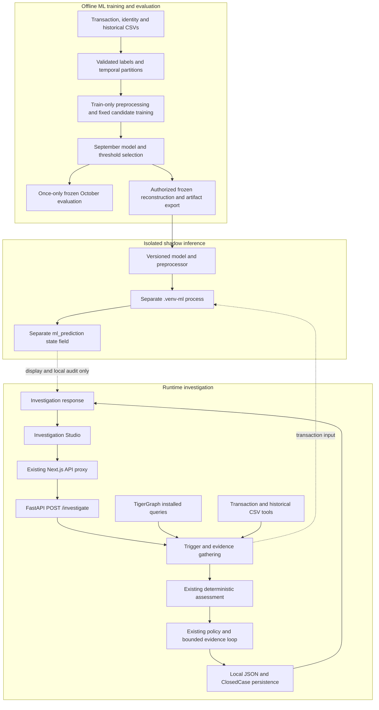

# Graph-Based Fraud Investigation with Leakage-Safe Machine Learning and Shadow-Mode Decision Support

**College AIML Project Report — Draft**  
Prepared: 1 October 2026 (Asia/Calcutta)

This draft describes the implemented system and previously verified results. It
does not report new experiments, training, live queries or test executions performed
for report preparation. Square-bracketed administrative entries and figure requests
are placeholders to be completed before submission.

For evidence locations, **R** denotes
`D:/agentic-fraud-investigation/tigergraph-fraud-agent/` and **F** denotes
`D:/agentic-fraud-investigation/tigergraph-fraud-frontend/tg/`. Paths using these
prefixes refer to the current local projects. Some experiment outputs and model
artifacts are intentionally excluded from Git and must be preserved separately.

## 1. Title Page

**Project title:** Graph-Based Fraud Investigation with Leakage-Safe Machine Learning and Shadow-Mode Decision Support

**Submitted by:** [Student names and registration numbers]  
**Programme:** [Official AIML programme name]  
**Semester:** Fifth Semester  
**Course:** [Course title and code]  
**Department:** [Department name]  
**Institution:** [College and university affiliation]  
**Project guide:** [Name and designation]  
**Academic year:** [Academic year]  
**Submission date:** [Date]

[Insert the approved institutional cover-page format and authorized logo.]

## 2. Certificate

[Insert the institution's prescribed certificate after guide/department approval.
Include the approved project title, student names, registration numbers, academic
year, guide and examiner details, signature spaces and date. This placeholder is
not a signed certificate or a claim of institutional approval.]

## 3. Declaration

[Insert the students' reviewed declaration of work, attribution and use of external
resources. Include any required disclosure of AI-assisted development/documentation.
Students must verify and sign the final declaration; this draft does not assert
individual authorship or originality on their behalf.]

## 4. Acknowledgement

[Add acknowledgements to the actual guide, department and people who supported the
project. Confirm names and contributions before inclusion. Do not imply a bank,
company partnership or dataset-provider endorsement that has not been established.]

## 5. Abstract

Fraud investigation requires more than assigning a score to an isolated transaction.
An investigator also needs related transactions, historical findings, evidence
quality and a traceable explanation of the recommended action. This project
implements a graph-based investigation system with a separately evaluated machine
learning component. A FastAPI service coordinates a bounded LangGraph workflow
that retrieves transaction data, executes four installed TigerGraph queries,
retrieves eligible historical cases and applies deterministic assessment and policy
rules. The investigation result is retained locally and written to an existing
ClosedCase representation in TigerGraph.

The supervised learning dataset is obtained from explicit historical case outcomes,
not from the existing risk score. Of 590,742 transactions, 14,955 have linked
historical labels. Temporal splitting, label-maturity checks and case-boundary
exclusions separate training, validation and final testing. A training-fitted
preprocessing pipeline converts 25 inputs into 245 transformed features. Majority,
Logistic Regression, Random Forest and XGBoost models are compared using September
validation data. XGBoost is selected by validation balanced accuracy, with Average
Precision as a tie-breaker. At its frozen threshold, the October test yields
precision 0.9917168675, recall 0.8593800979 and F1 0.9208180388.

The selected model is integrated in shadow mode: its score is displayed separately
from the existing risk score and does not determine policy actions. The labeled
sample is strongly fraud-heavy, so these results describe historically investigated
transactions rather than population-wide fraud detection. The project demonstrates
reproducible evaluation, graph-supported evidence organization and auditable
decision support without claiming calibrated probabilities or autonomous banking
actions.

## 6. Keywords

Fraud investigation; artificial intelligence and machine learning; TigerGraph;
XGBoost; temporal validation; data leakage; shadow inference; deterministic
grounding; LangGraph; decision support.

## 7. Table of Contents

[Generate the final table of contents, list of figures and list of tables after
institutional formatting and pagination. Use the numbered sections in this draft.
Page numbers are intentionally not fabricated.]

## 8. Introduction

A flagged financial transaction is a starting point for investigation, not a final
adjudication. A high score may indicate a need for review, while the final response
depends on the available evidence and applicable rules. Relationships between
transactions and shared entities can provide context that is difficult to obtain
from a single table row.

The project addresses this distinction through two complementary activities.
First, a graph investigation workflow retrieves connected evidence and produces
policy-based recommendations. Second, an offline supervised machine learning
experiment learns from transactions associated with explicit historical case
outcomes. Supervised learning means learning a mapping from input features to
known target labels. The resulting model is then exposed as an additional,
non-controlling signal during investigation.

The implementation combines a Next.js Investigation Studio, a FastAPI application
programming interface (API), a LangGraph workflow, a TigerGraph graph database and
an isolated Python ML environment. An API is the defined interface through which
the frontend requests an investigation. The system is a college research and
engineering prototype; it is not presented as a deployed banking platform.

Implementation evidence: `R/backend/main.py`, `R/backend/agent/workflow.py`,
`R/backend/ml/train.py` and `F/lib/api/backend.ts`.

## 9. Problem Statement

The project investigates how a transaction-level ML score can be combined with
graph evidence and an existing rule-based investigation process without allowing
the new score to silently replace the established decision mechanism.

Three technical problems are central. The transaction file does not contain a
direct fraud label, so supervised labels must be traced to historical adjudications.
Historical information can also leak into model development if future outcomes or
future transactions are used during training. Finally, the investigation must
remain usable when graph access or ML inference is unavailable.

The implemented solution therefore needs validated transaction-label joins,
time-aware evaluation, a separate shadow prediction field and explicit failure
states. It must retain the distinction between a classifier output, evidence of
fraud and a policy recommendation.

## 10. Motivation

The motivation is to build an understandable investigation system rather than a
standalone score generator. Graph relationships provide contextual evidence;
historical cases provide earlier findings; and deterministic policies make the
recommended actions inspectable. Separating these responsibilities helps explain
why an investigation reaches a particular recommendation.

The ML component also provides an opportunity to study realistic evaluation
problems. A large transaction file does not automatically provide a large labeled
training set. Class imbalance, selective historical review and label availability
must be addressed before interpreting model metrics. Shadow mode permits the new
score to be observed without changing the existing policy behavior.

No quantitative claim about fraud-loss reduction, analyst time savings or bank
deployment is made because those outcomes were not measured.

## 11. Objectives

The implemented project objectives are:

1. Extract transaction-level targets from explicit historical outcomes and validate
   every supervised join.
2. Separate training, validation and testing by transaction time, with label-maturity
   and case-boundary safeguards.
3. Build a reproducible, training-fitted feature pipeline and compare fixed ML models.
4. Retrieve TigerGraph relationship, pattern and velocity evidence for an investigation.
5. Combine available evidence through deterministic assessment and bounded orchestration.
6. Preserve existing policy decisions while exposing ML inference as a separate signal.
7. Retain local and graph-based case records with audit information and safe error states.
8. Display the investigation and separate ML assessment in the existing frontend.

The corresponding code is in `R/backend/ml/`, `R/backend/tools/`,
`R/backend/agent/workflow.py` and `F/components/investigation/MLAssessment.tsx`.

## 12. Scope

The implemented scope is a CSV-backed research prototype with a local API/frontend,
an existing TigerGraph database and a deterministic investigation workflow. It
supports case triggers, transaction validation, graph evidence, historical retrieval,
assessment, policy recommendations, case persistence and shadow ML scoring.

The supervised evaluation covers the labeled historical investigation sample.
Unlabeled transactions are not treated as legitimate examples. The 20 trigger cases
exercise the investigation system but do not form an independently labeled ML test.

The scope excludes autonomous financial actions, real customer communication,
external Suspicious Activity Report (SAR) filing, population-wide performance
claims, live Model Context Protocol (MCP) transport and vector-based retrieval.
The prototype's approval routes and report drafts describe recommended handling;
they are not proof that an external financial operation occurred.

## 13. Existing System

Within this project, the existing system is the transaction, graph and policy
workflow that preceded the new supervised model. It reads the dataset risk score,
collects related evidence, assesses uncertainty and applies deterministic policy
rules. The assessment retains the existing dataset score in the field named
`fraud_probability`; that field name does not establish that the score is calibrated.

This baseline already provides graph-supported investigation. The new ML work does
not replace it. Separately, the experimental majority classifier predicts the
majority training class and supplies a simple predictive baseline. These two uses
of “baseline” refer to different comparisons: application behavior and ML metrics.

No unverified description of a commercial bank's existing system is included.
Evidence: `R/backend/tools/assessment.py`, `R/backend/tools/policy.py` and
`R/backend/ml/training.py`.

## 14. Proposed System

The proposed system, now implemented, adds a validated XGBoost score to the existing
investigation. XGBoost is a gradient-boosted decision-tree method: successive trees
contribute to a combined prediction. Its trained configuration is selected offline,
exported with preprocessing metadata and loaded by an isolated inference worker.

The worker returns a score, frozen threshold, prediction, model version and feature
schema version. These appear in a separate `ml_prediction` field. The existing risk
score, evidence count, assessment and policy action are preserved. If inference
cannot complete, the worker reports an unavailable result with a null score rather
than a fabricated value.

This separation allows a reviewer to inspect agreement or disagreement between
signals without mistaking the ML classifier for the final decision authority.

## 15. System Architecture

The architecture separates three processes with different responsibilities.

| Part | Responsibility | Main implementation |
|---|---|---|
| A. Offline ML training/evaluation | Label extraction, temporal splitting, preprocessing, model comparison and frozen evaluation | `R/backend/ml/dataset.py`, `splits.py`, `preprocessing.py`, `training.py`, `train.py` |
| B. Runtime investigation | Trigger handling, evidence collection, assessment, policy and persistence | `R/backend/main.py`, `R/backend/agent/workflow.py`, `R/backend/tools/` |
| C. Shadow ML inference | Load versioned artifacts and score one transaction without modifying policy | `R/backend/tools/ml.py`, `R/backend/ml/shadow.py` |

The following source-derived diagram describes the implemented boundaries; it is
not a screenshot of a running deployment.



At runtime, shadow scoring occurs after evidence gathering and before the existing
assessment. The graph's control flow continues regardless of ML availability. There
is deliberately no ML output arrow into policy evaluation. The backend process
does not import the ML dependencies for scoring; it invokes the separate interpreter
with a bounded timeout. The runtime graph uses the existing pyTigerGraph SDK
(software development kit), not a connected MCP transport.

Figure placeholder: [Render and verify the final architecture figure with readable
labels, clearly retaining the offline/runtime/shadow separation.]

## 16. Dataset Description

Four source CSV files serve different roles:

| Source | Records | Role |
|---|---:|---|
| `transactions.csv` | 590,742 | Transaction attributes and existing risk score |
| `identity.csv` | 144,432 | Transaction-linked identity/device snapshots |
| `closed_cases_history.csv` | 5,565 | Explicit historical outcomes and transaction links |
| `case_pack.csv` | 20 | Investigation triggers, not final supervised outcomes |

Transactions span July–December 2016. The inspected transaction file has 397 columns,
including transaction amount/time, product, card/address fields, email domains,
masked C/D/M/V fields, customer, timestamp, channel and risk score. The V fields
extend through V339. The file does not provide a direct fraud target column.

The original dataset provider, license and independent provenance of the historical
outcomes have not been established from the available project evidence. These
details remain required before final submission. Similarity to a familiar public
schema is not sufficient to attribute the dataset to a provider.

Sources: `R/data/` and `R/backend/ml/results/configuration.json` (`source_audit`).
The configured tools use repository-root `data/`, not the duplicate `backend/data/`
directory.

## 17. Data Preparation

Data preparation opens the original CSVs read-only. Historical links are expanded
and joined to exact transaction identifiers. Validation rejects missing linked
transactions, repeated transaction links, conflicting labels, duplicate transaction
IDs and customer mismatches. It also checks that the label's closure time does not
precede its transaction.

Identity records are left-joined by TransactionID. A left join retains a transaction
even when no identity row exists. Within the labeled dataset, 8,404 transactions
have identity matches and 6,551 do not. Duplicate identity identifiers fail
validation rather than multiplying transaction rows.

Identifier and provenance fields are retained outside the predictive feature
dictionary. This separation keeps rows traceable without allowing case identifiers
or outcome metadata to become model inputs. Source files are never rewritten by
the audit or preprocessing command.

Evidence: `R/backend/ml/dataset.py`, `R/backend/ml/preprocessing.py` and their tests.

## 18. Label Generation

Here, label generation means extracting existing adjudications, not inventing fraud
labels. Each historical `txn_ids` field is split on `|`. Its explicitly linked
transactions receive the case's recorded outcome:

\[
y_i =
\begin{cases}
1, & \text{explicit historical outcome is confirmed\_fraud},\\
0, & \text{explicit historical outcome is cleared},\\
\text{unlabeled}, & \text{no historical transaction link exists}.
\end{cases}
\]

| Label category | Transactions |
|---|---:|
| Confirmed fraud | 14,055 |
| Cleared | 900 |
| Total labeled | 14,955 |
| Unlabeled, excluded from supervised learning | 575,787 |

The pipeline preserves `source_case_id`, `label_source`, `label_known_at` and
`closed_at`. The last two record when the adjudication became available. Unknown
historical outcomes cause a validation error rather than being silently mapped to
the cleared class.

No label is derived from risk_score, generated case JSON or agent actions. A shared
customer, card, device or email does not transfer a historical label to another
transaction. These are dataset-provided historical labels; their independent
real-world adjudication provenance remains unresolved.

Evidence: `R/backend/ml/config.py`, `R/backend/ml/dataset.py` and
`R/backend/tests/test_ml_dataset.py`.

## 19. Leakage Prevention

Data leakage occurs when model development uses information that would not have
been available at the intended prediction time. For example, a case closed in
September must not provide a label to a model represented as trained before
September.

The project uses the following half-open transaction windows. A half-open interval
includes its start and excludes its end.

| Partition | Transaction window | Label known strictly before | Retained rows |
|---|---|---|---:|
| Train | 1 July–1 September 2016 | 1 September 2016 | 6,371 |
| Validation | 1 September–1 October 2016 | 1 October 2016 | 2,836 |
| Test | 1 October–1 November 2016 | 7 November 2016 | 3,207 |

Label maturity means waiting until a historical outcome is actually available.
The November test cutoff permits October outcomes to mature for evaluation; it
does not permit their use in training. Cases whose linked transactions cross
partition boundaries are purged as entire cases before maturity filtering.

There are 1,462 case-boundary exclusions and 1,079 label-maturity exclusions, or
2,541 labeled transactions in total. All 14,955 labels are accounted for exactly
once across the three partitions and an explicit excluded bucket. Unlabeled rows
are excluded separately.

Preprocessing statistics and category vocabularies are fitted only on training
data. September supports model/threshold selection; October is reserved for the
final frozen evaluation. Outcomes, closure metadata, generated decisions, raw IDs
and risk_score are excluded from predictive features. Customers may still recur
across time, so this is a temporal evaluation of the investigation sample, not a
customer-disjoint generalization test.

Evidence: `R/backend/ml/splits.py`, `R/backend/ml/train.py` and
`R/backend/ml/results/configuration.json`.

## 20. Feature Engineering

Feature engineering converts transaction snapshots into consistent numerical
inputs. The core feature schema is named `core-v1`.

| Group | Inputs | Count |
|---|---|---:|
| Numeric measurements | TransactionAmt, dist1, dist2 | 3 |
| Derived transaction time | hour, weekday from ts | 2 |
| Product/channel | ProductCD, channel | 2 |
| Card codes | card1–card6 | 6 |
| Address codes | addr1, addr2 | 2 |
| Email domains | P_emaildomain, R_emaildomain | 2 |
| Device snapshot | DeviceType, DeviceInfo | 2 |
| Missingness indicators | Amount, both distances, both device fields and identity-row absence | 6 |
| **Total inputs before encoding** | **19 core variables plus 6 indicators** | **25** |

Card and address codes are categorical values, not ordered measurements. Numeric
inputs undergo finite-number conversion, training-median imputation and standard
scaling. Imputation replaces missing measurements using training-derived values;
scaling uses training mean and scale. Entirely missing training numeric columns
are retained with the configured imputer's zero fallback. Missingness indicators
preserve the distinction between missing source data and observed zero.

Categorical inputs use a missing sentinel and one-hot encoding, which represents
category membership through numerical indicator columns. Categories seen fewer
than five times are grouped, with a maximum of 32 output categories per categorical
field. Unseen categories use the fitted infrequent bucket when available, or an
all-zero group otherwise. This behavior is fixed by the training-fitted encoder.

The resulting matrices contain 245 transformed features: train 6,371×245,
validation 2,836×245 and test 3,207×245. They use compressed sparse row (CSR)
storage, which stores sparse numerical matrices efficiently. The 245 columns are
encoded outputs, not 245 separate raw measurements.

Anonymous `id_*`, C/D/M/V and graph-derived ML features are not included. Snapshot
availability of device and distance information is an explicit assumption because
the files do not independently record capture times for each attribute. No future
aggregates are created by this feature pipeline.

Evidence: `R/backend/ml/features.py`, `R/backend/ml/preprocessing.py` and the saved
configuration's ordered feature names and preprocessing statistics.

## 21. Machine Learning Methodology

The experiment compares a constant majority baseline, Logistic Regression,
Random Forest and XGBoost. Logistic Regression provides a regularized linear
classification baseline. Random Forest combines multiple decision trees. XGBoost
combines trees sequentially through gradient boosting. Logistic Regression and
Random Forest are each evaluated with unweighted and balanced class-weight variants.

Precision is the fraction of predicted fraud that is labeled fraud; recall is the
fraction of labeled fraud detected. F1 is their harmonic mean. Balanced accuracy
gives equal weight to fraud recall and cleared-class recall:

\[
\mathrm{Precision}=\frac{TP}{TP+FP},\qquad
\mathrm{Recall}=\frac{TP}{TP+FN},\qquad
F_1=\frac{2PR}{P+R}
\]

\[
\mathrm{BalancedAccuracy}=\frac{1}{2}
\left(\frac{TP}{TP+FN}+\frac{TN}{TN+FP}\right).
\]

ROC-AUC measures score ranking through the receiver operating characteristic
curve, which compares true-positive and false-positive rates across thresholds.
Average Precision (AP) summarizes the precision-recall relationship. The reported
AP is not trapezoidal precision-recall area. Alert rate is the fraction of
transactions predicted as fraud at the selected threshold.

For model score \(s_i\), the classifier predicts fraud when \(s_i\geq t\).
Each model's threshold maximizes September balanced accuracy. Threshold ties
prefer the value closest to 0.5 and then the lower threshold. Model selection
maximizes validation balanced accuracy, with AP and finally model name resolving
ties. A default threshold of 0.5 is not imposed.

Validation is used for both threshold and model selection. Therefore September
metrics are selection results, not an independent estimate of generalization.
October supplies the final frozen test evaluation. No synthetic oversampling,
random partitioning or test-driven tuning is performed.

## 22. Model Training

All candidate models use the same training partition and the same preprocessing
fitted on that partition. Balanced class weights change the fitting objective;
they do not change labels or generate additional rows.

| Model | Recorded configuration |
|---|---|
| Majority | Most-frequent training class |
| Logistic variants | C=1.0; liblinear solver; max_iter=2000; class_weight=None or balanced |
| Random Forest variants | 200 trees; max_depth=12; min_samples_leaf=5; max_features=sqrt; class_weight=None or balanced |
| XGBoost | 200 trees; max_depth=4; learning_rate=.05; subsample=1.0; colsample_bytree=1.0; reg_lambda=1.0; binary:logistic objective; histogram tree method |

The random seed is 42. Tree estimators use one processing thread. The recorded ML
environment uses Python 3.13.15, NumPy 2.5.3, SciPy 1.18.1, scikit-learn 1.9.1 and
XGBoost 3.4.1 in `backend/.venv-ml`, separate from the backend runtime environment.

The evaluation procedure is:

```text
Validate explicit historical labels and exact transaction joins.
Build the fixed temporal partitions and exclusion audit.
Fit preprocessing on train; transform train and September validation.
For each fixed candidate:
    Fit the candidate on train.
    Score validation and select its threshold using balanced accuracy.
Select the winning model using validation balanced accuracy, then AP.
Persist the chosen model name and frozen threshold.
Transform and score October once with the selected model.
Write metrics, prediction rows and reproducibility metadata.
```

The saved selection exists before October is transformed/scored. Prediction outputs
preserve transaction IDs and source case IDs. Configuration records include feature
names, versions, preprocessing statistics and ordered partition hashes, which are
digital fingerprints used to detect input changes.

Phase 3 did not save a binary model. A later explicitly authorized, deterministic
reconstruction exported the frozen selected configuration for shadow inference.
It reproduced 2,836 saved September predictions within absolute tolerance 1e-7
and did not repeat model selection or October evaluation. It is documented as a
reconstruction rather than recovery of the original in-memory fitted object.

Evidence: `R/backend/ml/training.py`, `train.py`, `export.py`,
`R/backend/ml/results/configuration.json` and the artifact manifest.

## 23. Model Comparison

The September validation set contains 2,730 fraud and 106 cleared transactions.
The following values use the saved results rounded to four decimal places.

| Model | Precision | Recall | F1 | Balanced accuracy | ROC-AUC | AP |
|---|---:|---:|---:|---:|---:|---:|
| Majority | .9626 | 1.0000 | .9810 | .5000 | .5000 | .9626 |
| Logistic | .9911 | .7359 | .8446 | .7830 | .8415 | .9925 |
| Balanced Logistic | .9933 | .7048 | .8245 | .7911 | .8431 | .9924 |
| Random Forest | .9945 | .7315 | .8430 | .8139 | .8555 | .9932 |
| Balanced Random Forest | .9958 | .6978 | .8206 | .8112 | .8546 | .9935 |
| **XGBoost** | **.9944** | **.8385** | **.9098** | **.8579** | **.9155** | **.9964** |

XGBoost wins the documented balanced-accuracy selection protocol. It does not win
every metric: the majority predictor obtains the largest fraud-class F1 because
almost every validation example is labeled fraud. Predicting all rows as fraud
gives it no cleared-class discrimination, reflected in balanced accuracy and
ROC-AUC of .5000. This demonstrates why reporting F1 alone would be misleading.

| Model | Validation-selected threshold | Validation alert rate |
|---|---:|---:|
| Majority | 1.0000000000 | 1.0000 |
| Logistic | .9468689262 | .7147 |
| Balanced Logistic | .7794770928 | .6830 |
| Random Forest | .9217175384 | .7080 |
| Balanced Random Forest | .7477341701 | .6745 |
| XGBoost | .8961541057 | .8117 |

Evidence: `R/backend/ml/results/validation_metrics.json` and
`R/backend/ml/reports/model_comparison.md`. [Insert a comparison figure with the
validation prevalence and model-selection rule in its caption.]

## 24. XGBoost Evaluation

The frozen XGBoost threshold is **0.8961541056632996**. The selected model was
evaluated once on October without retuning the threshold or refitting on September.

| Metric | October frozen test result |
|---|---:|
| Precision | .9917168675 |
| Recall | .8593800979 |
| F1 | .9208180388 |
| Balanced accuracy | .8522252602 |
| ROC-AUC | .9219688441 |
| Average Precision | .9958643159 |
| Alert rate | .8281883380 |

The confusion matrix is `[[120,22],[431,2634]]`, with rows representing actual
cleared/fraud and columns representing predicted cleared/fraud:

| Actual class | Predicted cleared | Predicted fraud |
|---|---:|---:|
| Cleared | TN = 120 | FP = 22 |
| Fraud | FN = 431 | TP = 2,634 |

True negatives (TN) are cleared transactions predicted cleared. False positives
(FP) are cleared transactions flagged as fraud. False negatives (FN) are fraud
transactions predicted cleared, and true positives (TP) are fraud transactions
flagged correctly. The model detects 2,634 of 3,065 labeled fraud transactions
and misses 431 at the frozen threshold. It flags 22 of 142 cleared transactions.

The class distribution is important to interpretation:

| Partition | Fraud | Cleared | Fraud prevalence |
|---|---:|---:|---:|
| Train | 5,733 | 638 | 89.99% |
| Validation | 2,730 | 106 | 96.26% |
| Test | 3,065 | 142 | 95.57% |

These are prevalence values within selected historical investigations. They are
not estimates of the fraud rate among all transactions. High precision and AP in
this sample do not establish production performance or calibrated probabilities.

Evidence: `R/backend/ml/results/test_metrics.json`, `selection.json` and
`october_predictions.csv`. [Insert a confusion-matrix figure with this class order;
any ROC/PR visualization should use saved predictions without new model selection.]

## 25. TigerGraph Architecture

TigerGraph stores the existing `HHGOA_Fraud` graph. A graph database represents
entities as vertices and relationships as edges, supporting traversal across
connected evidence. The implemented Python integration calls installed queries
through pyTigerGraph's `runInstalledQuery` method.

Observed query outputs include connected customers, cards, devices, emails,
regions and transactions. The persistence layer also inspects an existing ClosedCase
vertex schema and compatible relationship types. The local `tigergraph/` directory
does not contain the installed GSQL source, so this report does not invent a complete
graph schema or claim to reconstruct query semantics from response names alone.

GSQL is TigerGraph's query language. Four installed queries are reused without
rewriting them. Configuration is supplied through the launching process environment;
credentials are not part of this report.

MCP, or Model Context Protocol, is documented only as a possible transport adapter
boundary. No live MCP server/client transport is implemented. The operational path
remains the existing SDK integration.

Evidence: `R/backend/tools/tigergraph_client.py`, `R/backend/config/tigergraph.py`,
`R/backend/tests/fixtures/closedcase_schema.json` and `R/docs/tigergraph-mcp.md`.
[Insert a sanitized actual schema/graph screenshot before submission.]

## 26. Graph Investigation

Each graph investigation calls the following installed queries for the flagged
transaction ID:

| Query | Evidence exposed by the implemented adapter |
|---|---|
| `investigate_transaction` | Connected entities and related transaction identifiers |
| `risk_pattern_summary` | Related counts, risk-category counts and amount aggregates |
| `detect_fraud_patterns` | Aggregate small-online, online, risk and amount signals |
| `transaction_velocity` | Counts and amounts in reported 1h, 6h and 24h windows |

The graph tool preserves the raw query results for auditability and records query
provenance: the query name, graph, transaction and status/timing information.
Normalized status distinguishes complete, partial and unavailable evidence rather
than substituting zero for missing results.

The current HHG-001 case record contains all four query statuses as complete and
421 related transactions. Relationship is not proof of fraud: the volume of related
transactions must not be automatically interpreted as fraudulent exposure. Similarly,
small-online counts alone do not prove the ordered sequence required for card testing.

Graph evidence supports investigation and uncertainty assessment. These graph
aggregates are not inputs to the current XGBoost model, and their temporal
correctness for retrospective ML has not been established in this project phase.

Evidence: `R/backend/tools/graph.py`, `R/cases/HHG-001.json` and
`R/docs/tigergraph-integration.md`.

## 27. Agentic Investigation Workflow

The term agentic in this project refers to bounded tool orchestration: a workflow
selects and invokes evidence tools, assesses sufficiency and follows explicit
branches. LangGraph represents these steps and transitions. The implementation
does not use autonomous large-language-model reasoning or unlimited planning.

The trigger loader identifies the case and flagged transaction. Missing or mismatched
transactions result in controlled errors. Evidence gathering retrieves transaction,
graph and historical data. Shadow ML then populates a separate field, after which
the existing assessment and initial policy run.

If evidence is insufficient and customer verification is applicable, the workflow
records an evidence request. Because no real response service exists, the response
is explicitly marked `SIMULATED_UNAVAILABLE`, with `simulated=true` and response
`UNKNOWN`. It cannot count as new corroborating evidence. The workflow reassesses
and stops after at most two assessment iterations or when another stopping
condition is met. Initial and final decisions remain available for comparison.

```text
load case → validate transaction → gather graph/history → shadow score
          → assess → initial policy
          → [sufficient / no applicable request] final policy
          → [insufficient and applicable] record request
             → simulated-unavailable response → reassess → final policy
          → local and graph persistence
```

Evidence: `R/backend/agent/workflow.py` and `R/backend/models/state.py`.

## 28. Evidence Gathering and Historical Case Memory

The grounding layer organizes source-backed evidence into a structured context.
It includes the transaction and trigger, graph relationships/pattern/velocity
outputs, the actual policy implementation, documented fraud-pattern guidance and
eligible historical case findings. Missing and conflicting evidence are retained
explicitly.

This is deterministic GraphRAG-style grounding: graph and supporting sources are
retrieved and organized according to fixed code. It is not vector retrieval,
embedding similarity search or retrieval-augmented LLM generation. No vector
database is present in this implementation.

Historical memory reads `closed_cases_history.csv`. Cases must have closed by the
investigation's opening time. Matching uses transaction, card or customer identifiers;
pattern alone does not establish a match. The tool ranks eligible matches and
returns up to five with reasons such as `same_transaction`, `same_card` or
`same_customer`.

Historical fraud is contextual evidence, not automatic proof that the current
transaction is fraudulent. Assessment counts distinct corroborating signals rather
than the number of evidence containers. Its uncertainty object includes sufficient,
missing_evidence, conflicting_evidence, confidence and reason.

Evidence: `R/backend/tools/grounding.py`, `cases.py`, `assessment.py` under
`R/backend/tools/`, and `R/docs/fraud-patterns.json`.

## 29. Policy and Next Best Action

Next Best Action means the recommended operational response generated by the
existing policy rules. The policy function receives the existing assessment score,
verdict, pattern, exposure, evidence count, customer-response state and relevant
flags. It returns actions, explanations and approval routes.

For example, the implementation includes customer-verification, case-creation,
card-blocking, monitoring, analyst-escalation and report-draft recommendations under
specific conditions. A route such as `auto`, `L1` or `L2` indicates the configured
handling level; it does not prove that an external system executed the recommendation.

The ML score is not passed into this policy function. It does not replace
risk_score or independently cause BLOCK_CARD, CREATE_CASE, REVIEW, MONITOR or any
other action. For HHG-001, the recorded final action remains CREATE_CASE with
route `auto`, while the new ML score is displayed separately.

The policy remains a deterministic project implementation, not a claim of legal
compliance or a bank-approved operational policy. Evidence:
`R/backend/tools/policy.py`, `R/backend/agent/workflow.py` and
`R/backend/tests/test_shadow_integration.py`.

## 30. ML Shadow Mode

Shadow mode runs a model alongside the established process without allowing its
output to control that process. The inference adapter invokes
`backend/.venv-ml/Scripts/python.exe` as a separate worker with a 45-second timeout.
The production backend environment does not gain ML package dependencies.

The artifact directory contains `model.ubj`, `preprocessor.joblib` and a manifest.
UBJ is the native XGBoost model representation used here; joblib retains the fitted
preprocessor. The manifest records dependency versions, schema, feature width,
frozen threshold and file hashes. Joblib artifacts must be trusted local files:
checksums detect corruption, but do not authenticate an attacker-controlled manifest.

The model version is `xgboost-core-v1-seed42` and the feature schema is `core-v1`.
The original training timestamp was not recorded; the later export timestamp and
reconstruction protocol are recorded rather than invented as the original date.

| HHG-001 live field | Recorded value |
|---|---|
| Transaction | 3514030 |
| Existing risk_score | 0.61 |
| XGBoost fraud_score | 0.9814080595970154 |
| Frozen threshold | 0.8961541056632996 |
| Classifier prediction | fraud |
| Final policy action | CREATE_CASE |

The value 0.9814080595970154 is an **XGBoost fraud score**, not a calibrated
probability that the transaction is fraudulent. Classifier output `fraud` is not
an adjudication. A `cleared` classifier output likewise would not authorize closing
an investigation.

Missing artifacts, incompatible versions/schemas, timeouts or malformed inputs
produce an explicit unavailable state with null score/prediction and a sanitized
error code. There is no fabricated fallback score or fallback to zero. The result
is kept out of assessment grounding and policy evidence counting.

Evidence: `R/backend/tools/ml.py`, `R/backend/ml/shadow.py`,
`R/backend/ml/artifacts/xgboost-core-v1/manifest.json` and `R/cases/HHG-001.json`.

## 31. Frontend / Investigation Studio

The existing Next.js Investigation Studio calls the same API/client/adapter path.
The ML Fraud Assessment card appears on the Studio and Assessment pages. It shows
the XGBoost fraud score, model threshold, prediction, model name/version, feature
schema and the existing risk score as separate fields.

For the recorded HHG-001 response, the percentage presentation rounds the ML score
to 98.14%, the threshold to 89.62% and the existing risk score to 61.00%. These are
formatted live-response values, not hardcoded case defaults. The card states:

> ML prediction is an additional investigation signal and does not independently determine the final policy action.

While the investigation runs, the card displays loading rather than an old score.
Absent ML data produces a no-data state; unavailable or failed inference produces
a concise message. Error codes map to fixed frontend wording so stack traces and
raw exception details are not displayed. Older cached responses require a new
investigation to obtain the optional ML field.

The existing layout and workflow are preserved. Visual verification has been
confirmed by the user; screenshots must still be attached to the final report.
Evidence: `F/components/investigation/MLAssessment.tsx`,
`F/lib/data/ml-assessment.ts`, `F/lib/api/backend.ts` and the Studio/Assessment pages.

## 32. Case Persistence

Persistence means retaining the investigation result; it does not mean declaring
the case confirmed fraud. Each successful investigation writes
`cases/<case_id>.json` with trigger, transaction, graph/history evidence,
assessment, uncertainty, recommendations, approval routes, status and timestamps.
The shadow prediction is retained separately in this local record. Local writes
use atomic replacement to avoid leaving a partly written snapshot.

The graph-persistence tool first inspects the existing ClosedCase schema. It selects
a compatible existing string attribute for a tagged JSON investigation record;
the observed schema uses `outcome`. The payload identifies itself as an investigation
record rather than an adjudicated historical fraud label. Existing relationship
types are used only after compatible schema and target checks. No schema or edges
are invented.

The graph write reports success, failed or uncertain. An uncertain status reflects
an ambiguous remote outcome, such as a transport failure after submission. Local
case JSON remains available if graph persistence fails. Payload hashes support
read-back comparison, which retrieves the stored record and checks it against the
intended payload.

When policy requests FILE_REPORT, a structured SAR draft is written locally with
`externally_filed=false`. No external filing is claimed. Repeated case writes are
snapshots, not a complete event-history database.

The current HHG-001 snapshot reports persistence success. September acceptance and
benchmark read-back artifacts support earlier verification. They must not be
presented as read-back proof for a later October snapshot without matching the
case payload/run. Also, local storage of `ml_prediction` does not imply that every
ML field is included in the graph's mapped investigation payload.

Evidence: `R/backend/tools/artifacts.py`, `graph_persistence.py`,
`R/cases/HHG-001.json`, `R/cases/HHG-001-persistence-acceptance.json` and
`R/cases/benchmark_readback_verification.json`.

## 33. Testing

The following results were previously verified during implementation. **They were
not rerun specifically for report generation.**

| Verification | Previously verified result |
|---|---|
| Backend/integration suite | 72 tests passed |
| ML suite | 45 tests passed |
| Combined backend and ML | 117 tests passed |
| Frontend suite | 15 tests passed |
| TypeScript check | Passed |
| Production frontend build | Passed |

Backend tests cover triggers, missing transactions, graph response mapping,
historical retrieval, evidence handling, bounded workflow and persistence.
Shadow tests check that high, low and failed ML predictions do not alter assessment
or policy actions. ML tests cover label mapping, exact joins, split disjointness,
train-only fitting, unseen categories, missing values, deterministic feature width,
row/label/source-case alignment, thresholds, model output range and artifact errors.

Frontend tests cover response mapping, the existing single API path, separate score
rendering, threshold/prediction metadata, loading, unavailable/error states and
absence of case-specific hardcoded ML values. TypeScript provides static type
checking; the build verifies the application can compile for production use. A
successful build is not evidence of production load, security or banking readiness.

The suites use separate environments: backend/integration tests use `.venv` and ML
tests use `.venv-ml`. The frontend dev server was not running during its verified
production build. Dated command logs/screenshots remain required in the final
evidence appendix.

Evidence: `R/backend/tests/`, `F/tests/investigation.test.cjs`,
`F/tests/ml-assessment.test.cjs` and previously recorded verification results.

## 34. Results and Discussion

The results establish three different outcomes. The supervised experiment produces
a reproducible comparison and a frozen October result. Runtime evidence demonstrates
that HHG-001 can combine completed graph queries with a real shadow model score.
The UI exposes these values separately without changing the final policy action.

XGBoost achieves the highest validation balanced accuracy among the tested fixed
configurations. Its October balanced accuracy remains close to that validation
result, but this observation is limited to the available historical sample. The
431 test false negatives show that high precision does not mean every fraudulent
transaction is detected. The 22 false positives also matter because the cleared
test class contains only 142 transactions.

The majority predictor's high F1 and AP demonstrate how class prevalence influences
metrics. About 94% of the full labeled subset is fraud, and the retained validation
and test partitions exceed 95%. Those distributions are properties of historical
investigation selection, not estimated fraud prevalence in the full transaction
population. Unlabeled rows cannot resolve this by being treated as negatives.

The current HHG-001 record reports four graph queries complete, 421 related
transactions, an XGBoost score of 0.9814080595970154, unchanged risk_score 0.61 and
final CREATE_CASE recommendation. This demonstrates integration and policy
independence; it does not demonstrate that ML improved the final decision.

Earlier September benchmark artifacts report 20 completed investigations, zero
failures, 20 graph-complete cases and 20 successful persistence statuses. A separate
read-back artifact reports 20 verified records and 20 local cases preserved.
Their generation timestamps differ and require run reconciliation before being
presented as one acceptance run. These earlier artifacts are not a newly executed
20-case shadow-mode benchmark, nor are they an ML accuracy test.

Evidence: `R/backend/ml/results/`, `R/cases/HHG-001.json`,
`R/cases/benchmark_results.json` and `R/cases/benchmark_readback_verification.json`.

## 35. Limitations

The principal limitation is the selected nature of the labeled data. Its provider,
license and independent adjudication provenance remain unresolved. Only 900
historically cleared transactions are available before exclusions. The experiment
cannot establish population-wide precision, operational fraud-loss reduction or
calibrated risk from this sample.

Temporal splitting limits several leakage paths, but customers may recur across
partitions and masked card codes may permit entity memorization. Device/distance
availability is treated as a transaction-snapshot contract rather than independently
verified capture-time evidence. September is reused for threshold and model
selection. No confidence intervals, unseen-customer results or production drift
measurements are reported.

The runtime is bounded deterministic orchestration, not autonomous LLM reasoning.
Grounding is not embedding/vector retrieval. MCP is only an integration boundary.
Customer replies are explicitly simulated-unavailable; external financial actions
and SAR filing are not implemented. Approval routes express recommendations.

Artifact deserialization assumes a trusted local environment. Worker startup and
CSV scanning add latency, while persistence snapshots do not provide complete
event sourcing. Existing documentation contains historical blocked checkpoints;
their status must not override current artifacts or be silently relabeled as
current results. Screenshots and dated same-run read-back evidence remain needed
for the final documentation package.

## 36. Future Scope

Future work should begin with independently documented labels and representative
evaluation data. Additional cleared outcomes, label-quality review, customer-disjoint
tests, confidence intervals and calibration would support more careful score
interpretation. Drift monitoring and performance testing would be needed before
operational deployment claims.

Graph-derived ML features could be considered only after verifying that their
aggregations are available at prediction time and exclude future information.
Likewise, a real MCP adapter would require separate transport, authentication and
failure testing. Stronger artifact signing, persistent inference services and a
durable case-event history could address deployment limitations.

Real customer-response and approval integrations would require separate design,
authorization and validation. Any proposal to promote the ML score into policy
must be independently evaluated; shadow-mode success does not authorize that change.
These are future possibilities, not current delivered capabilities.

## 37. Conclusion

The project demonstrates a complete research-to-application path for a constrained
fraud investigation prototype. Historical outcomes are joined explicitly to
transactions, temporal safeguards protect training/evaluation boundaries, and
training-only preprocessing produces reproducible model inputs. XGBoost wins the
declared September validation protocol and is evaluated once on the frozen October
partition.

The selected model is then exposed through a versioned shadow inference path.
Graph investigation, deterministic grounding and historical retrieval continue to
support the existing assessment and policy rules. The frontend presents ML and
existing risk scores separately, while persistence retains the investigation audit.

The contribution is an inspectable integration of supervised ML with graph-supported
decision support—not a claim of calibrated population risk, autonomous banking
actions or proven reduction in real-world fraud. Final submission should retain
these boundaries and complete the outstanding provenance and evidence records.

## 38. Team Contributions

[Complete with verified contributors only. File ownership, individual effort and
authorship were not established by this documentation exercise.]

| Member name / registration number | Verified contribution | Supporting tasks/files | Confirmation |
|---|---|---|---|
| [Member 1] | [To confirm] | [Evidence] | [Pending] |
| [Member 2] | [To confirm] | [Evidence] | [Pending] |
| [Additional member, if applicable] | [To confirm] | [Evidence] | [Pending] |

[Include guide input, collaboration acknowledgements and AI-assistance disclosure
in accordance with the institution's actual requirements.]

## 39. References

[Bibliography pending verification and formatting in the college's required style.
Do not treat the following list as completed citations.]

| Required reference | Information to obtain |
|---|---|
| Dataset and historical outcomes | Provider, title, origin, license, adjudication provenance and access conditions |
| TigerGraph and pyTigerGraph | Official documentation used, applicable version and access date |
| LangGraph and FastAPI | Official framework references matching the implemented components |
| scikit-learn | Preprocessing, classifier and metric documentation for the recorded environment |
| XGBoost | Verified paper/software documentation citation and version 3.4.1 reference |
| NumPy and SciPy | Applicable software references and recorded versions |
| Next.js and React | Frontend framework references and relevant versions |
| Fraud evaluation/data leakage literature | Actual publications read and used; verified authors, titles, dates and DOI/URLs |

Local evidence sources are the approved outline, `R/docs/ml-design.md`,
`R/docs/tigergraph-integration.md`, `R/docs/tigergraph-mcp.md`, source modules,
saved experiment JSON and current case artifacts cited throughout the report.
They support implementation claims but do not substitute for an academic
bibliography. MCP should be cited only in the context of its documented boundary
or future scope, not as an operational transport used by the prototype.

## Evidence still required before final submission

Each figure or log should identify its source, capture date, relevant case/model
version and whether it represents a live result, an older artifact or a test.
Redact credentials, authorization headers and unnecessary personal/entity details.

- [ ] **Architecture diagram:** Render the source-derived diagram clearly; verify
  offline, runtime and shadow boundaries and the absence of ML control over policy.
- [ ] **ML comparison:** Attach the saved September comparison table/figure with
  balanced-accuracy selection rule and fraud-prevalence caption.
- [ ] **Confusion matrix:** Attach the October matrix with class order, frozen
  threshold, TN/FP/FN/TP and sample size. Any additional plots should use saved
  predictions, not a new tuning/evaluation run.
- [ ] **Frontend ML assessment:** Attach user-verified desktop/mobile screenshots
  showing separate scores, version/schema and shadow explanation, plus loading,
  no-data and unavailable/error states.
- [ ] **Live API path:** Preserve a sanitized same-run response and browser Network
  capture connecting the displayed case to the existing POST investigation path.
- [ ] **TigerGraph graph:** Attach actual schema/relationship screenshots and
  four installed query names/statuses. Obtain query/schema export only if authorized;
  do not reconstruct missing GSQL from assumptions.
- [ ] **Evidence panel:** Capture actual provenance, graph evidence and uncertainty;
  label deterministic grounding accurately.
- [ ] **Historical case memory:** Capture an eligible matched case, match reason
  and closure cutoff without unnecessary disclosure of customer data.
- [ ] **Final decision:** Show the same case's CREATE_CASE recommendation and route
  alongside the separate dataset risk score and XGBoost fraud score.
- [ ] **Persistence/read-back:** Obtain or identify matching current write/read-back
  payload/hash evidence for the shadow-era snapshot. Keep September proof separate
  until timestamps/run identity are reconciled.
- [ ] **Test results:** Attach dated logs for 72 backend/integration tests, 45 ML
  tests, 15 frontend tests, TypeScript success and production build success.
  Record environments and confirm no dev/build overlap.
- [ ] **Dataset provenance:** Complete provider/license and historical label meaning;
  retain an explicit limitation wherever these remain unresolved.
- [ ] **Split/preprocessing audit:** Attach counts, exclusion reasons, maturity
  cutoffs, 25-input/245-output schema and ordered feature metadata.
- [ ] **Reproducibility:** Preserve sanitized configuration/manifest, dependency
  versions, hashes and the authorized reconstruction note. Do not automatically
  publish binary models, prediction rows or environment secrets.
- [ ] **Administrative material:** Complete cover page, approved certificate,
  reviewed declaration, acknowledgement, contents/pagination and figure/table lists.
- [ ] **Team and bibliography:** Verify member contributions, guide details,
  external references and required AI-assistance disclosure.

This draft was produced from existing evidence only. No source code, model,
threshold, dataset, TigerGraph query, policy or frontend behavior was changed;
no new experiments or fake screenshots were created for this report.
